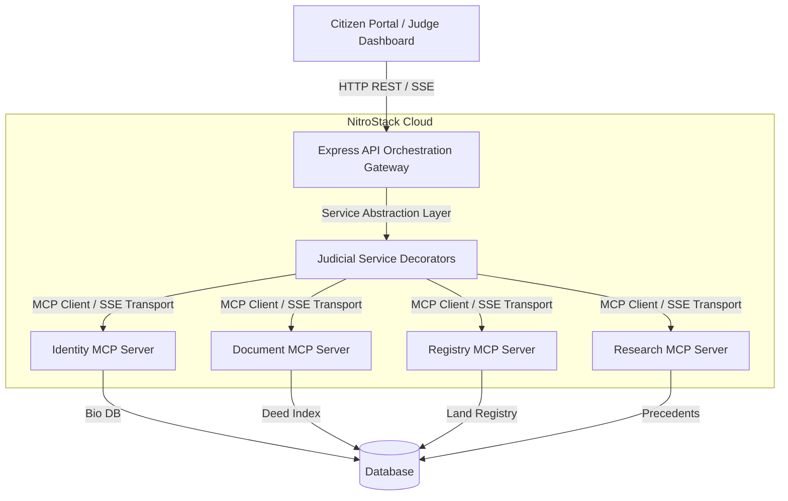

# NitroStack Deployment Implementation Plan (Option A)

For deploying NyayaOS to NitroStack successfully, we recommend **Option A** (Component-Based Cloud Architecture). This architecture keeps the central Orchestration and Client UIs inside the Express API/static apps, while deploying the discrete MCP servers (`Identity`, `Document`, `Registry`, `Legal Research`) as serverless/containerized endpoints on NitroStack.

## Proposed Strategy



---

## 0. Refactoring Existing MCP Servers (Domain Namespace Restructure)

The repository **already contains** the four scaffolded MCP packages inside `mcp/*`. However, they currently utilize the placeholder `modules/calculator/` folder structures and class names (e.g. `CalculatorTools` inside `calculator.tools.ts`), although they indeed implement the correct judicial tools (`verifyIdentity`, `checkJurisdiction`, etc.) via `@Tool` decorators.

To align with the **Three-Layer Naming Model**, we perform a namespace clean-up:

### Refactor Action Items

```
mcp/identity-server/src/modules/
├── calculator/ (delete)
└── identity/ (new)
    ├── identity.module.ts
    ├── identity.tools.ts
    └── ...
```

For each service:
1. **Rename Directories**: Rename `modules/calculator` to match the server's domain (`identity`, `document`, `registry`, `research`).
2. **Rename Classes/Files**:
   - `CalculatorTools` ➔ `IdentityTools` (within `identity.tools.ts`)
   - `CalculatorModule` ➔ `IdentityModule` (within `identity.module.ts`)
3. **Update Imports**: Update imports inside `app.module.ts` to reference the new domain module paths.

---

## 1. Upgrade `MCPManager` with Factory Pattern & Health Checks

Rather than creating transports manually, introduce an `MCPTransportFactory` and add connection verification to ensure each client is healthy upon initialization.

### Reusable Transport Factory

Create a factory class in `platform/mcp-manager/factory.ts` (or within index.ts):

```typescript
import { StdioClientTransport } from '@modelcontextprotocol/sdk/client/stdio.js';
import { SSEClientTransport } from '@modelcontextprotocol/sdk/client/sse.js';

export class MCPTransportFactory {
    static create(name: string, localPath: string) {
        const envVarName = `${name.toUpperCase()}_MCP_URL`;
        const productionUrl = process.env[envVarName];

        if (productionUrl) {
            console.log(`[MCP] Creating SSE Transport for ${name} pointing to: ${productionUrl}`);
            return new SSEClientTransport(new URL(productionUrl));
        }

        // Fallback to local Stdio for developer ease
        return new StdioClientTransport({
            command: 'node',
            args: [localPath],
            env: { ...process.env, NODE_ENV: 'development' }
        });
    }
}
```

### Health Verification & Ping

Before registering the client in the connection pool, confirm it is responding:

```typescript
const transport = MCPTransportFactory.create(s.name, serverPath);
const client = new Client(
    { name: `nyayaos-${s.name}-client`, version: '1.0.0' },
    { capabilities: {} }
);

await client.connect(transport);

// Health Check Verification:
try {
    await Promise.race([
        client.listTools(), // Or client.ping() depending on protocol version support
        new Promise((_, reject) => setTimeout(() => reject(new Error('Connection Timeout')), 3000))
    ]);
    console.log(`[MCPManager] Connected and verified ${s.name} server.`);
} catch (err) {
    console.error(`[MCPManager] Failed health check for ${s.name}:`, err);
    throw err;
}
```

---

## 2. Introduce Resilient Service Abstractions

Decouple the Express API / Workflow Engine from the direct MCP client calls by creating service classes that implement timeouts, retry logic, and caching.

```
Workflow Engine
      │
      ▼
Judicial Service Layer (e.g. IdentityService)
      │
      ├─► Timeout wrapper (Promise.race)
      ├─► Retry logic (exponential backoff)
      └─► Caching (Precedent Lookup cache)
```

### Retry with Backoff Helper

```typescript
async function retryWithBackoff<T>(fn: () => Promise<T>, retries = 3, delay = 1000): Promise<T> {
    try {
        return await fn();
    } catch (error) {
        if (retries <= 0) throw error;
        console.warn(`[MCP Retry] Request failed. Retrying in ${delay}ms... (Remaining: ${retries})`);
        await new Promise(res => setTimeout(res, delay));
        return retryWithBackoff(fn, retries - 1, delay * 2);
    }
}
```

### Timeout & Precedent Cache Implementation

Wrap Precedent lookups with a short-duration cache (e.g., 15 minutes) and execution timeouts to prevent workflow hangs:

```typescript
import NodeCache from 'node-cache';
const precedentCache = new NodeCache({ stdTTL: 900 }); // 15 mins TTL

export class LegalResearchService {
    static async getPrecedent(disputeType: string) {
        const cached = precedentCache.get(disputeType);
        if (cached) return cached;

        const mcpClient = MCPManager.getInstance().getClient('research');
        
        // Timeout (10000ms) + Retry + Run
        const result = await Promise.race([
            retryWithBackoff(() => mcpClient.callTool({
                name: 'getPrecedent',
                arguments: { disputeType }
            })),
            new Promise((_, reject) => setTimeout(() => reject(new Error('Research Timeout')), 10000))
        ]);

        precedentCache.set(disputeType, result);
        return result;
    }
}
```

---

## 3. Parallel Execution Logic (Reduce Latency)

In your workflow manager/orchestrator, execute independent checks concurrently to significantly reduce end-to-end trace latency.

```typescript
// 1. Run independent validation checks in parallel
const [identityRes, documentRes, registryRes] = await Promise.all([
    IdentityService.verify(inputData.parties),
    DocumentService.validate(inputData.evidence),
    RegistryService.lookup(inputData.property)
]);

// 2. Run sequential dependency step (Legal Precedent) after checks resolve
let precedentsRes = null;
if (identityRes.status === 'COMPLETED' && registryRes.status === 'COMPLETED') {
    precedentsRes = await LegalResearchService.getPrecedent(inputData.case.caseType);
}
```

---

## 4. Structured JSON Logging

Replace unstructured terminal printing with standardized JSON output schema to facilitate logs ingestion and debugging in cloud environments.

```typescript
function logEvent(workflowId: string, service: string, status: 'SUCCESS' | 'FAILED' | 'RETRYING', duration: number, details?: any) {
    console.log(JSON.stringify({
        timestamp: new Date().toISOString(),
        workflowId,
        service,
        durationMs: duration,
        status,
        ...details
    }));
}
```

## 5. Deployment Setup Checklist

Each subdirectory in `mcp/` is maintained as a standalone deployable node project:
*   `package.json` with `@nitrostack/core` dependency.
*   Independent `tsconfig.json` compiling TS to native CommonJS/ESM modules.
*   Entry point `src/index.ts` booting the server.

### Deploying to NitroCloud

Deployment is handled via **NitroCloud** (the hosting platform for NitroStack applications) rather than a CLI-based push subcommand:

1. **Local Compilation Check**:
   Confirm each server builds correctly locally:
   ```bash
   cd mcp/identity-server
   npm run build
   ```
2. **NitroCloud Connection**:
   Connect your GitHub repository containing `NyayaOS` to your **NitroCloud** dashboard.
3. **Application Configuration**:
   Register each server individually on NitroCloud by specifying their subdirectories:
   * Identity server: `mcp/identity-server`
   * Document server: `mcp/document-server`
   * Registry server: `mcp/registry-server`
   * Research server: `mcp/research-server`
4. **Trigger Deployment**:
   NitroCloud will run the build steps and compile the TS files into the production runtime, generating hosted SSE endpoints for your orchestrator to target.
